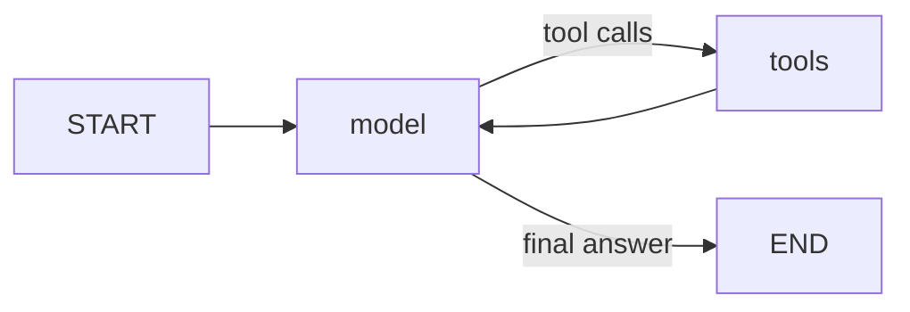
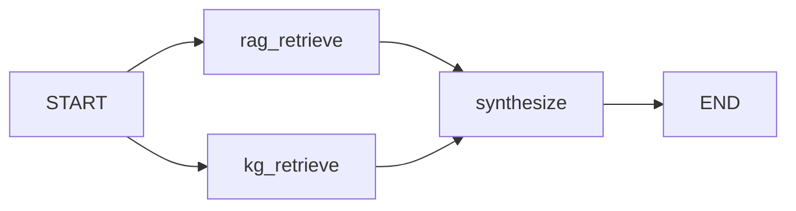

# PM Assistant — RAG + Knowledge Graph agent with MCP actions

A project-manager / contractor-assignment chatbot for a fictional consultancy, **Northwind Labs**.
Ask it about people, skills, availability, projects, clients and policies, or ask it to staff a
project, take someone off a project, create or update tasks, or trigger workflows. **One LLM
(Claude) decides on its own, by native tool calling, whether a message needs information or an
action** — there is no router, keyword matching or if/else on the user's text anywhere.

```
                      ┌──────────────────────── top-level agent (LangGraph, create_agent) ─┐
 user ─► chat UI ─►   │  model (Claude) ◄──► tools                                          │
 (passive)            │                       ├─ ask_knowledge_base ─► INFO GRAPH (RAG + KG)│
                      │                       └─ MCP action tools  ─► MCP SERVER (stdio)    │
                      └──────────────────────────────────────────────────────────────────────┘
```

## Architecture

### 1. Top-level agent — `src/pm_assistant/agent/`
`build_agent()` is LangChain's `create_agent`: the standard **model ⇄ tools** loop. Its tools are:

- `ask_knowledge_base` — the single, read-only entry point to the informational graph;
- **every tool the MCP server publishes**, discovered at start-up with `langchain-mcp-adapters`
  (`agent/mcp_tools.py`). Names, descriptions and JSON schemas come from the server.

The system prompt (`agent/prompts.py`) describes the two *kinds* of capability and never names a
tool, so the model chooses from whatever is bound. Two stock-style middlewares wrap the existing
nodes without adding any: one asks the model for one tool call per step (so "make this change,
then tell me about it" reads the new state), the other turns a failing tool (crashed or stuck
action server) into an error message for the model instead of an aborted turn.



### 2. Informational graph — `src/pm_assistant/info/` (RAG + KG, centralized)
Every information question goes through **one compiled LangGraph** (`info_subgraph`). Both
retrievers run in parallel for every question and a synthesizer combines them with citations:



- **RAG** (`info/rag.py`): markdown corpus in `data/corpus/` (policies, workflows handbook,
  project briefs, meeting notes), chunked by section, retrieved with BM25 (deterministic and
  offline). It is lexical retrieval, not embeddings: anything implementing `Retriever` (e.g. a
  vector store) can be swapped in without touching the graph.
- **Knowledge Graph** (`info/kg.py`): a `networkx` multi-digraph of people, skills, clients,
  projects, assignments, tasks and workflow runs, built from the **read-only** store on every
  query, so it always reflects actions already taken. Relations: `HAS_SKILL`, `ASSIGNED_TO`,
  `LEADS`, `FOR_CLIENT`, `REQUIRES_SKILL`, `HAS_TASK`, `ASSIGNEE_OF`, `HAS_WORKFLOW`; derived facts
  such as `free_capacity_pct`. Facts are retrieved by combining (1) entities the question names,
  (2) BM25 entity linking, expanded two hops with the attributes of every entity reached, and
  (3) BM25 over individual facts — which is what answers aggregate questions such as "who has
  the most free capacity?".
- **Synthesis** (`info/subgraph.py`): Claude answers only from the retrieved evidence, citing
  `[doc:<id>]` and `[kg]`; graph facts win on current state.

The pipeline is also registered on its own in `langgraph.json` (`info_pipeline`) so it can be
inspected in LangGraph Studio.

### 3. MCP server — `src/pm_assistant/mcp_server/` (the only action mechanism)
A FastMCP server over **stdio** exposing only action tools (no read tools, so information can't
bypass the RAG + KG graph):

| Tool | Input schema (JSON Schema generated from the type hints) | `destructiveHint` |
|---|---|---|
| `assign_contractor` | `person`, `project`, `role`, `allocation_pct` (integer 1–100) | true (may update an assignment) |
| `end_assignment` | `person`, `project` — also queues the offboarding workflow | true |
| `create_task` | `project`, `title`, optional `assignee`, `due_date` (`YYYY-MM-DD`) | false |
| `update_task_status` | `task`, `status` (enum `todo`/`in_progress`/`blocked`/`done`) | true |
| `trigger_workflow` | `workflow` (enum `kickoff`/`offboarding`/`escalation`), `project` | false |

Each tool has a description, annotations and an `outputSchema` (`ActionResult`). People,
projects and tasks can be given by id, by full name, or by whole words of the name that identify
a single record ("Kenji", "Fraud Detection"); fragments or ambiguous references are rejected with
the candidates, so an action never lands on a record the user didn't name. Business rules (no
allocation above a person's availability, no changes to closed projects) are checked inside one
`BEGIN IMMEDIATE` transaction, so they hold even when several actions run at once. Violations
return `isError: true`; the agent reads the error and explains it. Every change, with the
previous values when something is overwritten, is written to an audit log. `trigger_workflow`
records a request in the workflow queue (status `queued`); executing workflows is out of scope.

**Adding a capability = adding one `@mcp.tool` function.** The agent picks it up the next time
it starts, with no change to its code (see `tests/fixtures/extended_mcp_server.py` and the
`escalate_risk` turn of the smoke test).

### Separation of the two sides
- `mcp_server` never imports `info`/`agent`; `info` never imports `mcp`, the MCP server, the
  store's write/seed code or `sqlite3`; `agent` and `ui` never touch the store
  (enforced by `tests/test_architecture.py`, which resolves every import form).
- They share only a **data contract**: the SQLite file. The MCP server is its only writer (it also
  seeds it on first start); the KG opens it in SQLite read-only mode (`mode=ro`), so the
  informational graph physically cannot change anything. Before the store exists, the KG reads an
  in-memory copy of the seed data instead.

### Where conditionals exist, and why none of them is routing
- `create_agent`'s own edges (model → tools when it emits tool calls, → END when it answers) —
  the model's decision, not ours.
- Retrieval inside the info graph (which documents/facts rank highest) — ranking, after the model
  already chose to ask for information; both retrievers always run.
- Business rules inside the MCP server — validation of an action the model already chose.
- `agent/` and `ui/` contain no `if`, ternary, `match`, comparison, regex or string matching at all
  (AST-checked by `tests/test_architecture.py`).

**Honest limits.** "Information always goes through RAG + KG" is enforced by design — the only
source of company data the agent has is the knowledge tool — but whether a given turn calls it is
the model's choice, guided by the system prompt (which tells it to query fresh in every turn).
`scripts/smoke.py` measures this on a real conversation. Each action spawns a short-lived MCP
server process (~1–2 s); tool discovery happens once per process.

## Setup

Requires [uv](https://docs.astral.sh/uv/) and an Anthropic API key.

```bash
uv sync
```

Set the key in your shell — bash: `export ANTHROPIC_API_KEY=...`; PowerShell:
`$env:ANTHROPIC_API_KEY="..."`. On Windows also set `PYTHONIOENCODING=utf-8` for `langgraph dev`
(bash: `export PYTHONIOENCODING=utf-8`; PowerShell: `$env:PYTHONIOENCODING="utf-8"`).

Optional environment variables (see `.env.example`): `PM_MODEL` (default `claude-sonnet-5-5`),
`PM_SYNTH_MODEL`, `PM_DB_PATH` (default `%LOCALAPPDATA%/pm-assistant/pm.db` on Windows,
`$XDG_DATA_HOME` or `~/.local/share/pm-assistant/pm.db` elsewhere — kept outside synced folders),
`PM_SEED_DIR`, `PM_CORPUS_DIR`, `PM_MCP_SERVER_CMD` (JSON array — point the agent at a different
MCP server), `PM_MCP_TIMEOUT_S` (default 60), `PM_RAG_K`, `PM_KG_HOPS`.
Reset the demo data with `uv run python -m pm_assistant.store.seed --reset`.

## Run it — pick any chat UI (all passive)

**LangChain Agent Chat UI (recommended)** — start the LangGraph server:

```bash
uv run langgraph dev --allow-blocking
```

Open <https://agentchat.vercel.app>, set *Deployment URL* `http://localhost:2024` and
*Assistant / Graph ID* `pm_assistant`. LangGraph Studio opens from the same command and also shows
the `info_pipeline` graph. (`--allow-blocking` is needed because the MCP stdio client makes a
blocking `shutil.which` call when it spawns the action server.)

**Gradio:** `uv run pm-gradio` → <http://127.0.0.1:7860>

**Terminal:** `uv run pm-chat` (exit with Ctrl+C)

**Inspect the MCP server on its own:** `npx @modelcontextprotocol/inspector uv run pm-mcp-server`

**Optional — as an MCP server for VS Code / Copilot:** `.vscode/mcp.json` registers
`pm-assistant`, the whole agent behind one `ask` tool (the agent still decides internally).

### Try these
- *Who could take backend work on the Fraud Detection Engine, and how much capacity do they have?*
- *What is our policy for contractors charging more than 100 USD an hour?*
- *Who has the most free capacity right now?*
- *Assign Kenji Sato to the Fraud Detection Engine as backend engineer at 40%.*
- *How much free capacity does Kenji have now?* (the KG reflects the assignment)
- *Mark the HIPAA audit log schema task as in progress, then tell me who is on that team.*
- *Kenji is leaving Fleet Telemetry — take him off that project.* / *Hi, thanks!* (no tools)

## Verification

| Evaluation criterion | Proof |
|---|---|
| Informational queries go through a centralized RAG + KG flow | `tests/test_info_subgraph.py` (topology; each question retrieves the expected document AND graph facts, including aggregate and multi-hop questions; nested trace); smoke: every info turn runs `info_subgraph` |
| Actions always execute through the MCP server | `tests/test_mcp_server.py` (real stdio session), `tests/test_routing.py`, `tests/test_kg_sync.py` |
| The agent selects the route autonomously | `tests/test_routing.py` (same text, different model decisions → different routes); `scripts/smoke.py` with real Claude: 11 turns incl. follow-ups, an aggregate question, Spanish, small talk, a mixed request and a new tool |
| No manual conditional logic | `tests/test_architecture.py` (AST scan of `agent/` + `ui/`, graph = model ⇄ tools only, prompt names no tool) |
| Modular / tools added without touching routing | `tests/test_dynamic_tools.py` + smoke extension turn (`escalate_risk` from an extended server) |
| MCP server uses correct schemas | `tests/test_mcp_server.py` (inputSchema types, enums, bounds, required, annotations, outputSchema, isError) |
| UI is passive | `tests/test_ui.py` (CLI and Gradio only forward to the graph; `langgraph.json` loads) |

```bash
uv run pytest -q              # offline, no API key needed (fake model, real MCP server)
uv run ruff check .
uv run python scripts/smoke.py          # real Claude, throw-away database
uv run python scripts/check_server.py   # against a running `langgraph dev`
```

## Project layout

```
src/pm_assistant/
  agent/       graph.py (create_agent + factory), mcp_tools.py (discovery), prompts.py
  info/        rag.py, kg.py, subgraph.py (RAG ‖ KG → synthesize), tool.py (ask_knowledge_base)
  mcp_server/  server.py (FastMCP action tools), __main__.py
  store/       schema.py, seed.py, read.py (read-only), write.py (actions)
  ui/          cli.py, gradio_app.py
  agent_mcp_server.py   optional: the whole assistant as an MCP server
data/corpus/   documents for RAG        data/seed/   structured records for the KG
tests/         offline test-suite       scripts/     smoke.py, check_server.py
langgraph.json graphs for `langgraph dev` / Agent Chat UI / Studio
```
